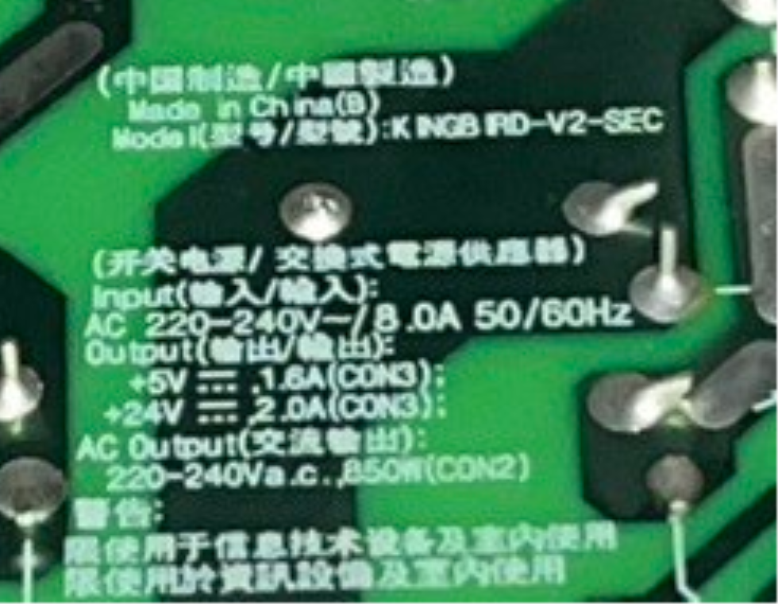
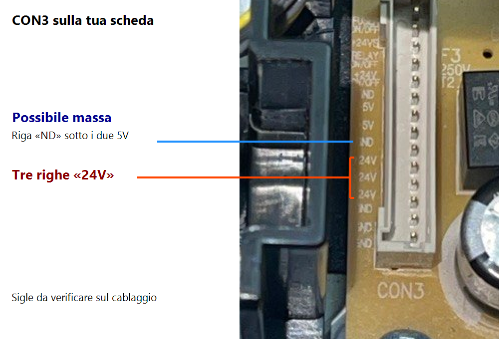
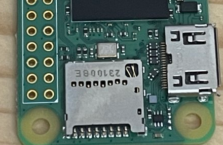

# Mettere il Wi-Fi ad una Samsung Xpress M2675F grazie a Raspberry Pi Zero 2 W

Un Raspberry Pi esterno fa da server per una multifunzione USB. La stampante alimenta il Pi, che entra nella rete Wi-Fi di casa e avvia automaticamente CUPS per la stampa e scanservjs per lo scanner. La modifica è stata provata su una **SL-M2675F/SEE**, con alimentatore **KINGBIRD-V2-SEC, revisione 0.2**. Se vuoi realizzare soltanto la parte di rete, alimenta il Pi con un alimentatore esterno adatto e passa direttamente al punto 2.

| Funzione | Riscontro sull’esemplare |
|---|---|
| Scanner USB su Raspberry | Foglio acquisito dal vetro a 100 dpi, grigio. Il PNG di 832 × 1189 pixel è stato aperto su Windows. |
| Server di stampa | Coda IPP associata alla Samsung USB. Un PDF inviato da Windows è entrato in coda. La prima pagina su carta rimane da verificare dopo il ripristino del toner. |
| Stato consumabili | Con cartuccia rimossa il Pi vedeva un lavoro in elaborazione. La risposta IPP non riportava livello toner o causa dell’arresto. |
| Server dopo il riavvio | CUPS, Avahi e scanservjs attivi. Restano da provare scansione dal browser, stampa da Android e AirPrint da iPhone. |

## 1. Alimentazione e cablaggio

Occorrono un Pi Zero 2 W, microSD, contenitore isolante, adattatore micro-USB OTG host e cavo dati USB-A/B. Per l’alimentazione interna servono una derivazione adatta al cablaggio, isolamento, fissaggio antistrappo e verifica elettrica sulla specifica macchina.

**L’alimentatore della stampante contiene parti a 230 V e condensatori che possono mantenere carica anche a spina staccata.** Affida l’intervento interno a una persona qualificata. Tieni scollegati rete elettrica, Pi e USB durante il cablaggio. Le misure in funzione si eseguono su punti di prova esterni isolati del secondario, a protezioni rimontate. Le foto servono a riconoscere i componenti.



Sul nostro alimentatore la targhetta assegna a **CON3** due uscite continue: **+5 V, 1,6 A** e **+24 V, 2,0 A**. **CON2 porta tensione di rete.** I valori di CON3 sono totali per ciascuna linea e comprendono il consumo della stampante. Due contatti con la scritta 5V condividono la stessa linea.



1. Identifica il cablaggio tra CON3 e il connettore della scheda madre marcato **5V_SMPS**. Nella foto i due `5V` sono sopra il tratto blu. La scritta al tratto blu è leggibile solo in parte. Il rosso raggruppa le righe **24V**, da escludere per questo collegamento diretto. Verifica la massa sulla tua revisione. Evita di dedurre un pin dal colore dei fili, dal telaio o dall’ordine specchiato della spina.
2. Per rintracciare un filo, scollega il solo fascio a entrambe le estremità e controlla la continuità fra i due capi del medesimo conduttore. Per misurare la tensione, usa V⎓, nero in COM sulla massa verificata e rosso in V/Ω sul candidato +5 V. Il multimetro in modalità corrente posto direttamente fra i due fili cortocircuita l’uscita.
3. Verifica **polarità e tensione all’estremità destinata al Pi** e margine di corrente con carico rappresentativo durante stampa, scansione e standby. Su questo esemplare l’utilizzatore ha letto **5,19 V** nei tre stati e ha riferito esito positivo sotto carico. Corrente del carico e durata non sono state registrate. Un multimetro può perdere cali molto brevi.
4. Realizza una **derivazione in parallelo** sul cablaggio a bassa tensione, mantenendo la connessione originale. Dimensiona conduttori e protezione del nuovo ramo secondo il cablaggio effettivo; isola ogni giunzione e proteggi il passaggio dal telaio. Il Pi usa la linea 5 V diretta. Lascia scollegato il convertitore XL4005.

```text
CON3 +5 V verificato ────────────── pin fisico 2 (5V)  ┐
CON3 GND verificata ─────────────── pin fisico 6 (GND) ├─ Pi Zero 2 W
                                                       │
USB-B Samsung ─ cavo A/B ─ adattatore OTG host ─ porta USB dati del Pi
                                                 PWR IN libera
```



**Orientamento:** guarda la scheda dal lato componenti, come nella foto, con microSD in basso e fila di fori a sinistra. All’estremità vicina alla microSD la piazzola quadrata è il pin fisico 1. Nella colonna verso il bordo esterno il primo foro dal basso è **2 (+5 V)**, il secondo è **4 (+5 V)** e il terzo è **6 (GND)**. Si usano 2 e 6. Il lato saldature inverte la vista. Controlla i riferimenti prima di saldare. Proteggi i contatti, blocca i cavi e rimonta tutte le protezioni prima di alimentare. Evita la contemporanea alimentazione da GPIO e PWR IN, inclusi accessori USB che possano retroalimentare il Pi. [Piedinatura Raspberry Pi](https://www.raspberrypi.com/documentation/computers/raspberry-pi.html#gpio)

## 2. Preparare il Raspberry

Con Raspberry Pi Imager seleziona **Zero 2 W**, **Raspberry Pi OS Lite 32-bit** e la microSD corretta. La scrittura cancella la scheda. Nella personalizzazione imposta hostname **stampante-pi**, utente **stampa**, una password personale, Wi-Fi **2,4 GHz**, paese corretto e SSH. I programmi Windows inclusi usano questi nomi. Per le immagini recenti con cloud-init si possono personalizzare anche i file esistenti `user-data` e `network-config` su `bootfs` prima del primo avvio. Conserva le credenziali sul tuo PC. [Imager](https://www.raspberrypi.com/software/) · [Configurazione al primo avvio](https://www.raspberrypi.com/news/cloud-init-on-raspberry-pi-os/)

Inserisci la microSD a Pi spento. Al primo avvio attendi qualche minuto. Da PowerShell di Windows:

```powershell
ssh stampa@stampante-pi.local
```

Sul Pi digita `lsusb`. Il dispositivo atteso è **04e8:3461 Samsung M267x 287x Series**. Se Windows non risolve il nome, trova il Pi nell’elenco DHCP del router. Una prenotazione DHCP aiuta a mantenere stabile il suo IP.

## 3. Installare scanner e stampa

Scarica o clona il progetto completo ed estrailo in una cartella Windows. Con Pi e stampante accesi, apri **Installa server Samsung.cmd**. Richiede i comandi Windows `ssh` e `scp`, connettività Internet dal Pi e la password dell’utente con accesso sudo. Sullo Zero 2 W l’estrazione di scanservjs può durare molti minuti. Lascia alimentato il Pi. In alternativa, copia `samsung-server.sh` e `samsung-splix-2.0.2.drv` nella stessa cartella sul Pi ed esegui `sudo bash samsung-server.sh` da quella cartella.

L’installatore configura il gruppo scanner, l’accesso USB per questo ID, scanservjs, Avahi, CUPS e la coda **Samsung-M2675F**. Usa il filtro SpliX installato dal sistema e, se manca il modello, il profilo Samsung fornito da OpenPrinting. **Completa stampa Samsung.cmd** ripete la sola configurazione della coda dopo l’installazione iniziale. Conserva tutti i file nella stessa cartella. Il rilascio scanservjs osservato era 3.3.0; l’installatore richiede il rilascio corrente.

Dal Pi controlla:

```bash
systemctl is-active scanservjs cups avahi-daemon
lpstat -v Samsung-M2675F
lpstat -o
```

Tre servizi attivi e una destinazione `usb://Samsung/…` confermano la configurazione. Per collaudarla occorrono un foglio fisico stampato e una scansione aperta su un dispositivo client.

## 4. Usare il server dalla rete domestica

| Operazione | Procedura |
|---|---|
| Scanner da telefono o PC | Apri **http://stampante-pi.local:8080**, seleziona il dispositivo e il vetro, acquisisci e scarica subito il risultato sul client. |
| PDF da Windows | Installa Python 3 per Windows con Tkinter e comando `python` disponibile. Apri **Stampa PDF Samsung.cmd** e scegli un PDF di prova di una sola pagina. **Stato Samsung.cmd** consulta la coda anche senza inviare documenti. |
| Stampa da iPhone/Android | Sulla stessa LAN apri un PDF e seleziona Stampa. Cerca Samsung M2675F; la compatibilità va collaudata sul dispositivo. |
| Coda CUPS | **http://stampante-pi.local:631/printers/Samsung-M2675F**. Per client IPP usa **ipp://stampante-pi.local:631/printers/Samsung-M2675F**. La registrazione Windows con `Add-Printer -IppURL` ha restituito 0x80070bc4 nel caso provato. |

Il client PDF segue il job e segnala se lo stato rimane invariato. Con cartuccia assente, CUPS mostrava *Rendering completed* e nessun motivo di errore. Se manca il foglio, controlla display, toner e carta prima di reinviare il documento. Per annullare solo un lavoro, leggi il suo identificativo con `lpstat -o` e usa `cancel IDENTIFICATIVO` con i permessi appropriati. Limita l’accesso alla LAN di fiducia, senza inoltro delle porte SSH, CUPS o scanner dal router verso Internet.

### Diagnosi dello scanner

Se la pagina di CUPS dice «L’interfaccia web è stata disabilitata», avvia **Abilita pagina CUPS.cmd** da Windows. Richiede la password SSH e sudo. Abilita la pagina della coda e verifica la risposta HTML. Sul Pi con overlayroot salva anche la direttiva nella configurazione di base e controlla che la microSD torni in sola lettura. Mantieni alimentato il Pi fino al messaggio di verifica.

Se `scanimage -L` non trova nulla, usa il nome completo con bus e dispositivo ricavati **al momento** da `lsusb`. Nell’esempio il bus è 001 e il dispositivo 002; al ricollegamento possono cambiare.

```bash
sudo scanimage -d xerox_mfp:libusb:001:002 -A
sudo scanimage -d xerox_mfp:libusb:001:002 --source Flatbed --mode Gray --resolution 100 -x 210 -y 297 --format=png > prova.png && file prova.png
```

Questa è la prova riuscita sul Pi. Per confrontare i permessi del servizio esegui `sudo -u scanservjs scanimage -L`. Il successo con sudo da solo non verifica l’accesso dell’app web. [Diagnostica scanservjs](https://sbs20.github.io/scanservjs/docs/04-troubleshooting.html)

## 5. Proteggere la microSD e verificare la ripartenza

Prova prima i servizi, scarica le scansioni e svuota la coda. Da SSH esegui `sudo raspi-config`, scegli **Performance Options → Overlay File System** e abilita sia l’overlay sia la protezione della partizione di boot. Riavvia dal menu e mantieni l’alimentazione durante la preparazione. Riconnettiti e controlla:

```bash
findmnt -n -o FSTYPE /
findmnt -n -o TARGET,OPTIONS /boot/firmware
swapon --show
systemctl is-active cups avahi-daemon scanservjs
lpstat -p Samsung-M2675F
sudo vcgencmd get_throttled
```

Sul banco: root `overlay` con base ext4 in sola lettura e modifiche in RAM, boot `ro`, nessuno swap attivo, tre servizi attivi, coda abilitata e `throttled=0x0`. Ripeti l’ultimo controllo dopo una stampa e una scansione. Il risultato copre il periodo dall’ultimo avvio.

Le scritture temporanee, i lavori pendenti e i file acquisiti possono sparire allo spegnimento. Attendi la fine delle operazioni e salva i documenti sul client. Per manutenzione permanente disattiva entrambe le protezioni, riavvia, applica e prova le modifiche, quindi riattiva le protezioni e riavvia. Conserva una copia privata della microSD a sistema arrestato e prova il ripristino su una seconda scheda. L’overlay riduce le scritture e il rischio di corruzione; la continuità del lavoro durante un’interruzione richiederebbe alimentazione di riserva. [Documentazione Raspberry Pi](https://www.raspberrypi.com/documentation/computers/configuration.html#enable-or-disable-overlay-file-system)

## Pannello di stato e download automatico

La personalizzazione in `pi-status.js` e `web-panel.js` mostra ogni 15 secondi memoria disponibile, temperatura e dimensione totale dei documenti sul Pi. Dopo una nuova scansione il browser richiedente riceve il file completo, avvia il download e chiede al server di cancellare la copia e la miniatura. Se il trasferimento fallisce, il file rimane sul server. Il pulsante «Salva di nuovo sul dispositivo» conserva una copia nel browser per ripetere il salvataggio anche dopo la cancellazione dal Pi. Ricaricare o chiudere la pagina perde questa copia. Safari e altri browser possono richiedere di autorizzare i download. Verificare il documento in Download prima di chiudere la pagina.

Per applicare il pannello a scanservjs 3.x, copiare i tre file `pi-status.js`, `web-panel.js` e `install-web-panel.py` nella stessa directory sul Pi, quindi eseguire `sudo python3 install-web-panel.py` e `sudo systemctl restart scanservjs`. Con overlayroot occorre salvare i quattro file installati nella configurazione di base oppure eseguire l’installazione nella fase di manutenzione con protezione disabilitata. Un aggiornamento scanservjs può richiedere di riapplicare il pannello.

## Provenienza

Il file `samsung-splix-2.0.2.drv` deriva da `ppd/samsung.drv.in` con le definizioni `#import` espanse dal rilascio SpliX 2.0.2. Mantiene gli avvisi degli autori; la licenza upstream è in [licenze/SpliX-COPYING](licenze/SpliX-COPYING). [Sorgenti del rilascio](https://github.com/OpenPrinting/splix/releases/tag/2.0.2) · [scanservjs](https://github.com/sbs20/scanservjs)

